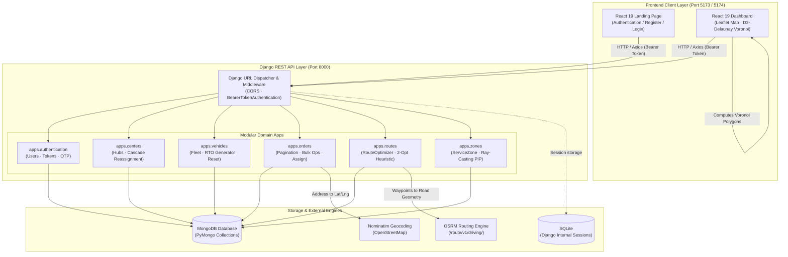

# Routiqo

**Intelligent Fleet Dispatch. Optimized Routes. Smarter Last-Mile Logistics.**

Routiqo is an intelligent, full-stack logistics management platform engineered to resolve the "Last-Mile Delivery" challenge. It pairs spatial partitioning, road-network route optimization, capacity balancing, and real-time interactive mapping to automate fleet dispatch operations.

---


---

## Table of Contents

- [Overview](#overview)
- [Screenshots](#screenshots)
- [Core Features](#core-features)
- [Technology Stack](#technology-stack)
- [System Architecture](#system-architecture)
- [Project Directory Structure](#project-directory-structure)
- [Installation and Local Setup](#installation-and-local-setup)
- [Environment Variables](#environment-variables)
- [Application Workflow](#application-workflow)
- [Algorithms and Engineering Details](#algorithms-and-engineering-details)
- [API Documentation](#api-documentation)
- [Testing](#testing)
- [Engineering Decisions](#engineering-decisions)
- [Limitations](#limitations)
- [Roadmap](#roadmap)
- [Author](#author)

---

## Overview

In modern supply chain management, the "last mile" represents up to 53% of total shipping costs. Dispatching drivers manually creates overlapping vehicle coverage, wasted mileage, unbalanced driver workloads, and missed customer delivery windows.

**Routiqo** replaces manual dispatching with automated, mathematically sound algorithms:

1. **Voronoi Spatial Partitioning** divides service regions into non-overlapping geometric territories using D3-Delaunay, assigning every customer order to the closest delivery hub.
2. **Dynamic Order Capture & 10 km Radius Constraint** ensures delivery hubs only manage orders within a strict 10 km operational perimeter, while automatically capturing unassigned orders when new hubs open.
3. **Nearest-Neighbor + 2-Opt Heuristics** sequence stops by distance and priority, minimizing total closed-tour distances.
4. **OSRM Road Network Routing** queries real-world road networks to generate turn-by-turn geometries, true driving distances, and accurate travel times rather than straight-line Euclidean approximations.
5. **Fleet Capacity Balancing** distributes packages evenly across available vehicles according to each vehicle's physical capacity limit.
6. **Centralized Interactive Dashboard** visualizes hubs, orders, routes, and playback of simulated vehicle movements in a React 19 interface.

---

## Screenshots

> Visual assets should be saved in `docs/screenshots/`.

| Dashboard & Map View | Territory Partitioning |
|:---:|:---:|
| *(Add `docs/screenshots/dashboard-map.png`)* | *(Add `docs/screenshots/voronoi-zones.png`)* |
| **Interactive Leaflet map showing hubs, orders & active routes** | **Voronoi service zone boundaries computed via D3-Delaunay** |

| Route Optimization & Fleet Details | Order Management |
|:---:|:---:|
| *(Add `docs/screenshots/route-details.png`)* | *(Add `docs/screenshots/order-management.png`)* |
| **Step-by-step turn sequence, leg distances, and stop ETAs** | **Paginated order overview with bulk filtering and status actions** |

---

## Core Features

- **Delivery Center (Hub) Management**: Complete CRUD operations for distribution centers. Creating a hub triggers automatic order capture of nearby orders. Deleting a hub gracefully cascades by removing its assigned vehicles/zones, reassigning orphaned orders to remaining hubs, and clearing planned routes.
- **Vehicle & Fleet Management**: Track vehicle capacities, operational availability, and average speeds. Automatically generates Indian RTO vehicle registration prefixes based on hub location names (e.g., `UP32` for Lucknow, `DL01` for Delhi, `MH01` for Mumbai).
- **Order Management & Geocoding**: Manage deliveries with address geocoding via OpenStreetMap Nominatim. Orders can be filtered by date, delivery center, or status (`pending`, `assigned`, `delivered`). Bulk actions include date clearing, completed order removal, and bulk delivery marking.
- **Voronoi-Based Spatial Partitioning**: Computes non-overlapping service polygons across delivery centers using `d3-delaunay` on the client and validates membership via ray-casting point-in-polygon checks on the backend.
- **Nearest-Neighbor & 2-Opt Optimization**: Combines greedy nearest-neighbor stop ordering with 2-opt pairwise edge exchange heuristic for high-efficiency route discovery without the exponential latency of exact TSP solvers.
- **OSRM Road Geometry**: Directly calls the Open Source Routing Machine (`/route/v1/driving/`) to render street-conforming GeoJSON polylines on Leaflet.
- **Simulated Rider Movement**: Renders smooth vehicle marker animation along planned route coordinates using time-step interpolation.
- **Sanctum-Compatible Authentication**: High-security user authentication with bcrypt password hashing (supporting `$2y$` and `$2b$` formats), personal access tokens (SHA-256 hashed), and 6-digit email OTP password resets.

---

## Technology Stack

### Backend

| Technology | Version | Purpose |
|---|---|---|
| **Python** | 3.12+ | Core runtime language |
| **Django** | 5.x / 6.x | High-level web framework and request handling |
| **Django REST Framework** | 3.15+ | REST API architecture, serializers, and permissions |
| **PyMongo** | 4.6+ | Direct MongoDB driver for high-performance document operations |
| **django-cors-headers**| 4.3+ | Cross-Origin Resource Sharing control for React clients |
| **bcrypt** | 4.1+ | Cryptographic password hashing and cross-platform verification |
| **requests** | 2.31+ | Synchronous HTTP client for OSRM and Nominatim integrations |
| **python-dotenv** | 1.0+ | Twelve-factor application environment variable management |
| **pytest & pytest-django**| 8.0+ | Automated unit, API, and integration test suite |
| **mongomock** | 4.3+ | In-memory MongoDB mock for isolated, network-independent tests |

### Frontend

| Application | Technology | Version | Purpose |
|---|---|---|---|
| **Dashboard** | **React** | 19.x | Component-driven dispatch interface |
| | **Vite** | 8.x | Frontend build tool and rapid development server |
| | **Tailwind CSS** | 4.x | Utility-first responsive styling and dark mode |
| | **Leaflet / React-Leaflet** | 1.9 / 5.x | Interactive mapping, markers, polylines, and popups |
| | **D3-Delaunay** | 6.x | Client-side Voronoi diagram and Delaunay triangulation |
| | **Axios** | 1.x | Promise-based HTTP client with Bearer auth interceptors |
| | **Framer Motion** | 12.x | Fluid UI animations, modals, and panel transitions |
| | **Lucide React** | 1.x | Modern UI iconography |
| **Landing** | **React & Tailwind CSS**| 19.x / 4.x | Product presentation, account registration, and authentication |

### Database & External Services

| Service | Role |
|---|---|
| **MongoDB (Atlas / Community)** | Primary persistent document database (`delivery_centers`, `vehicles`, `orders`, `routes`, `route_stops`, `service_zones`, `users`, `personal_access_tokens`) |
| **SQLite (`db.sqlite3`)** | Internal Django storage for session management and admin infrastructure |
| **OSRM (Open Source Routing Machine)** | Road-network driving geometry, distance computation, and duration matrices |
| **Nominatim (OpenStreetMap)** | Forward geocoding of textual customer addresses into latitude/longitude coordinates |

---

## System Architecture



---

## Project Directory Structure

```
Routiqo/
├── Backend/                         # Active Django backend
│   ├── manage.py                    # Django management CLI script
│   ├── requirements.txt             # Python backend dependencies
│   ├── pytest.ini                   # Pytest test suite configuration
│   ├── .env.example                 # Example environment variables
│   ├── config/                      # Core Django project configuration
│   │   ├── __init__.py
│   │   ├── settings.py              # Settings (DB, CORS, DRF, OSRM, Auth)
│   │   ├── urls.py                  # Master API URL router
│   │   ├── wsgi.py                  # WSGI server entry point
│   │   └── asgi.py                  # ASGI server entry point
│   ├── apps/                        # Domain-driven Django applications
│   │   ├── authentication/          # User auth, Sanctum tokens, OTP reset
│   │   ├── centers/                 # Delivery center CRUD & order capture
│   │   ├── vehicles/                # Fleet vehicles, RTO prefix generator
│   │   ├── orders/                  # Orders, filtering, pagination, bulk ops
│   │   ├── routes/                  # Route generation, OSRM dispatch
│   │   └── zones/                   # Voronoi polygon persistence & PIP check
│   ├── core/                        # Reusable architectural utilities
│   │   ├── database.py              # PyMongo connection & ObjectId query wrappers
│   │   ├── authentication.py        # BearerTokenAuthentication & bcrypt verify
│   │   ├── helpers.py               # Haversine, RouteOptimizer (2-Opt), Timing
│   │   ├── serializers.py           # Document serializing & formatting
│   │   └── exceptions.py            # Centralized DRF exception handlers
│   └── tests/                       # Automated pytest suite (31 tests)
│       ├── conftest.py              # Mock MongoDB & test client fixtures
│       ├── test_auth.py             # Auth endpoints & OTP lifecycle tests
│       ├── test_centers.py          # Center CRUD & cascade reassignment tests
│       ├── test_vehicles.py         # Vehicle management & RTO prefix tests
│       ├── test_orders.py           # Orders, bulk counts & radius filter tests
│       ├── test_zones.py            # Voronoi zone persistence & check tests
│       └── test_optimization.py     # Haversine, NN, 2-opt, PIP unit tests
│
├── Dashboard/                       # React 19 Dispatch Dashboard
│   ├── package.json                 # Dashboard frontend dependencies
│   ├── vite.config.js               # Vite build & plugin configuration
│   ├── public/                      # Static assets & icons
│   └── src/
│       ├── App.jsx                  # Root dashboard routing & layout
│       ├── context/AppContext.jsx   # State manager (routes, hubs, vehicles, playback)
│       ├── components/
│       │   ├── Map/                 # MapView (Leaflet, polylines, Voronoi cells)
│       │   ├── Route/               # FleetOverview, RouteDetailsPanel
│       │   ├── Forms/               # AddCenter, AddOrder, AddVehicle modals
│       │   └── UI/                  # Modal, Drawer, Table, Badge, Toast
│       ├── services/api.js          # Axios API client with token interceptor
│       └── utils/                   # Geometry, coordinates, simulation helpers
│
├── Landing/                         # React 19 Landing Page
│   ├── package.json                 # Landing page dependencies
│   ├── vite.config.js               # Vite build configuration
│   └── src/
│       ├── App.jsx                  # Marketing pages, login, and registration
│       ├── components/              # Navbar, Features, Footer, Testimonials
│       └── services/api.js          # Authentication API calls
│
├── docs/
│   └── screenshots/                 # Application screenshots & diagrams
│
├── .gitignore                       # Root git ignore specification
└── README.md                        # Master project documentation
```

---

## Installation and Local Setup

### Prerequisites

- **Python**: `3.12+`
- **Node.js**: `20.x` or `22.x+` (NPM `10.x+`)
- **MongoDB**: Local MongoDB server on port `27017` or a MongoDB Atlas connection URI
- **Git**: Installed on your system

---

### Step 1: Clone the Repository

```bash
git clone https://github.com/YOUR_USERNAME/Routiqo.git
cd Routiqo
```

---

### Step 2: Backend Setup (Django)

```bash
# Create and activate Python virtual environment
python3 -m venv .venv

# On Linux / macOS:
source .venv/bin/activate

# On Windows:
.venv\Scripts\activate

# Install backend dependencies
cd Backend
pip install -r requirements.txt

# Configure environment file
cp .env.example .env

# Run database synchronization for Django internal tables
python manage.py migrate

# Perform Django configuration check
python manage.py check

# Start Django development server
python manage.py runserver 0.0.0.0:8000
```

The Django REST API is live at `http://localhost:8000`.  
Health check verification: `http://localhost:8000/up`

---

### Step 3: Landing Page Setup (React)

Open a new terminal window:

```bash
cd Landing

# Install Node dependencies
npm install

# Configure environment
cp .env.example .env.local

# Start Vite dev server
npm run dev -- --port 5173
```

The Landing page is live at `http://localhost:5173`.

---

### Step 4: Dashboard Setup (React)

Open another terminal window:

```bash
cd Dashboard

# Install Node dependencies
npm install

# Configure environment
cp .env.example .env.local

# Start Vite dev server
npm run dev -- --port 5174
```

The Dashboard is live at `http://localhost:5174`.

---

## Environment Variables

### Backend (`Backend/.env`)

```dotenv
# Django Configuration
DJANGO_SECRET_KEY=your_secure_django_secret_key_here
DEBUG=True
ALLOWED_HOSTS=localhost,127.0.0.1,0.0.0.0

# MongoDB Configuration
MONGODB_URI=mongodb://localhost:27017
MONGODB_DATABASE=logiroute

# CORS Allowed Origins
CORS_ALLOWED_ORIGINS=http://localhost:5173,http://localhost:5174
CORS_ALLOW_ALL_ORIGINS=False

# External Routing & Geocoding
OSRM_ENDPOINT=https://router.project-osrm.org
APP_NAME=Routiqo
APP_URL=http://localhost:8000

# Email (SMTP Configuration for Password Reset OTP)
EMAIL_BACKEND=django.core.mail.backends.smtp.EmailBackend
EMAIL_HOST=smtp.gmail.com
EMAIL_PORT=587
EMAIL_USE_TLS=True
EMAIL_HOST_USER=
EMAIL_HOST_PASSWORD=
DEFAULT_FROM_EMAIL=noreply@routiqo.com
```

### Dashboard (`Dashboard/.env.local`)

```dotenv
VITE_API_URL=http://localhost:8000/api
VITE_LANDING_URL=http://localhost:5173
VITE_DASHBOARD_URL=http://localhost:5174
VITE_APP_NAME=Routiqo
```

### Landing Page (`Landing/.env.local`)

```dotenv
VITE_API_URL=http://localhost:8000/api
VITE_LANDING_URL=http://localhost:5173
VITE_DASHBOARD_URL=http://localhost:5174
VITE_APP_NAME=Routiqo
```

---

## Application Workflow

1. **Authentication**: Users register on the Landing page (`:5173`). Credentials are verified and a Bearer token is issued.
2. **Hub Initialization**: The dispatcher creates distribution hubs (name, latitude, longitude) on the Dashboard (`:5174`).
3. **Territory Tessellation**: As soon as two or more hubs exist, the dashboard calculates a Voronoi diagram using D3-Delaunay, partitioning the area into distinct territories and saving them to the backend.
4. **Order Ingestion & Geocoding**: Orders are entered with addresses. If coordinates are absent, Nominatim geocodes them. Orders within 10 km of a hub are assigned; others remain pending.
5. **Dynamic Fleet Allocation**: Vehicles are provisioned with capacities. Orders for a selected delivery date are clustered among available vehicles using a fair-share ceiling calculation.
6. **Route Optimization**:
   - Priority deliveries are grouped and sequenced first.
   - Initial tours are constructed using nearest-neighbor greedy selection.
   - A 2-opt local search pass reverses sub-tours to untangle crossing paths and reduce distance.
7. **OSRM Geometry & ETA Calculation**: Stops are dispatched to OSRM to obtain turn-by-turn driving polylines. Arrival ETAs are computed based on vehicle speed and a 3-minute dwell time per stop.
8. **Interactive Visual Dispatch & Playback**: The dispatcher views vehicles, hubs, and customer stops on the Leaflet map and can trigger simulated rider movement along the OSRM polyline.

---

## Algorithms and Engineering Details

### 1. Voronoi Spatial Partitioning

Given a set of delivery hubs $H = \{h_1, h_2, \dots, h_k\}$, a Voronoi diagram partitions $\mathbb{R}^2$ into cells $V(h_i)$ such that:

$$V(h_i) = \{ p \in \mathbb{R}^2 \mid d(p, h_i) \le d(p, h_j), \; \forall j \ne i \}$$

Where $d(p, h)$ denotes the Euclidean or geodesic distance. Any order placed within $V(h_i)$ is geometrically closest to hub $h_i$. In Routiqo, these polygons are computed on the client via `d3-delaunay` and stored in MongoDB. Ray-casting point-in-polygon checks confirm containment.

### 2. Haversine Distance Formula

All inter-stop distances compute geodesic surface distance on an Earth sphere radius $R = 6371.0\text{ km}$:

$$\Delta\sigma = 2 \arcsin \left( \sqrt{\sin^2\left(\frac{\Delta\phi}{2}\right) + \cos\phi_1 \cos\phi_2 \sin^2\left(\frac{\Delta\lambda}{2}\right)} \right)$$

$$d = R \cdot \Delta\sigma$$

### 3. Nearest-Neighbor Heuristic

To construct an initial tour from depot $h_0$ visiting orders $O$:
1. Current point $p \leftarrow h_0$, unvisited set $U \leftarrow O$.
2. While $U \ne \emptyset$, select $o^* = \arg\min_{o \in U} d(p, o)$.
3. Tie-breaking prioritizes orders tagged `priority`.
4. Append $o^*$ to tour, $p \leftarrow o^*$, $U \leftarrow U \setminus \{o^*\}$.
5. Return to depot $h_0$.

Time complexity: $\mathcal{O}(n^2)$.

### 4. 2-Opt Tour Improvement

The 2-opt heuristic iteratively removes two non-adjacent edges $(u_i, u_{i+1})$ and $(u_j, u_{j+1})$ from the tour and reconnects $(u_i, u_j)$ and $(u_{i+1}, u_{j+1})$ by reversing the segment between $i+1$ and $j$. If:

$$d(u_i, u_j) + d(u_{i+1}, u_{j+1}) < d(u_i, u_{i+1}) + d(u_j, u_{j+1}) - \epsilon$$

the reversal is accepted and the tour is updated. This eliminates path self-intersections and reduces total tour distance.

---

## API Documentation

All routes are prefixed with `/api/` (except root health checks) and return JSON.

### Authentication Endpoints

| Method | Endpoint | Auth | Description |
|---|---|---|---|
| `POST` | `/api/auth/register` | Public | Register new user account (`name`, `email`, `password`) |
| `POST` | `/api/auth/login` | Public | Authenticate user; returns Sanctum-compatible Bearer token |
| `POST` | `/api/auth/forgot-password` | Public | Generate and email 6-digit password reset OTP (valid 15 mins) |
| `POST` | `/api/auth/verify-otp` | Public | Verify validity of 6-digit OTP code |
| `POST` | `/api/auth/reset-password` | Public | Reset password using verified OTP and revoke existing tokens |
| `POST` | `/api/logout` | Bearer | Revoke active access token |
| `GET` | `/api/user` | Bearer | Fetch authenticated user profile |

### Delivery Centers (Hubs)

| Method | Endpoint | Auth | Description |
|---|---|---|---|
| `GET` | `/api/centers` | Bearer | List all delivery hubs for authenticated user |
| `POST` | `/api/centers` | Bearer | Create a new hub; captures unassigned orders within 10 km |
| `PATCH` | `/api/centers/<id>` | Bearer | Update hub details (`name`, `latitude`, `longitude`) |
| `DELETE` | `/api/centers/<id>` | Bearer | Cascade delete hub, its vehicles, and reassign orders |

### Fleet Vehicles

| Method | Endpoint | Auth | Description |
|---|---|---|---|
| `GET` | `/api/vehicles` | Bearer | List vehicles; optionally filter by `?delivery_center_id=` |
| `POST` | `/api/vehicles` | Bearer | Create vehicle; auto-generates RTO vehicle number |
| `PATCH` | `/api/vehicles/<id>` | Bearer | Update vehicle capacity, speed, or availability |
| `DELETE` | `/api/vehicles/<id>` | Bearer | Delete vehicle and clean up associated planned routes |
| `POST` | `/api/vehicles/reset-fleet`| Bearer | Reset all vehicle loads to 0 and set `is_available: true` |

### Orders

| Method | Endpoint | Auth | Description |
|---|---|---|---|
| `GET` | `/api/orders` | Bearer | Paginated order list (`status`, `date`, `delivery_center_id`) |
| `POST` | `/api/orders` | Bearer | Create order; geocodes address and auto-assigns nearest hub |
| `PATCH` | `/api/orders/<id>` | Bearer | Update order properties (`priority`, `delivery_date`, `address`)|
| `DELETE` | `/api/orders/<id>` | Bearer | Delete single order document |
| `DELETE` | `/api/orders` | Bearer | Bulk delete orders; optionally filtered by `?date=` |
| `POST` | `/api/orders/<id>/assign` | Bearer | Manually assign an order to its nearest hub (fails if > 10 km) |
| `GET` | `/api/orders/date-counts` | Bearer | Daily order counts for calendar view (`?year=&month=`) |
| `GET` | `/api/orders/bulk-counts` | Bearer | Summary counts (`completed`, `pending`, `total`) for date |
| `DELETE` | `/api/orders/clear-by-date`| Bearer | Clear all orders for specified `?date=` |
| `DELETE` | `/api/orders/completed` | Bearer | Delete all delivered orders |
| `DELETE` | `/api/orders/pending` | Bearer | Delete all pending orders |
| `POST` | `/api/orders/mark-all-delivered` | Bearer | Mark all active orders for date as delivered |

### Route Optimization & Service Zones

| Method | Endpoint | Auth | Description |
|---|---|---|---|
| `GET` | `/api/routes` | Bearer | List all optimized routes |
| `POST` | `/api/routes/generate` | Bearer | Optimize and generate routes for date and optional hub |
| `GET` | `/api/routes/<id>` | Bearer | Get route details with sequenced stops and OSRM geometry |
| `POST` | `/api/routes/regenerate/<center_id>` | Bearer | Clear and regenerate routes for a specific delivery hub |
| `POST` | `/api/routes/vehicle/<id>/generate` | Bearer | Generate optimized route for a specific vehicle |
| `DELETE` | `/api/routes/clear` | Bearer | Clear planned routes and revert orders to pending |
| `GET` | `/api/zones` | Bearer | Retrieve saved Voronoi service zones |
| `POST` | `/api/zones/generate` | Bearer | Replace persisted Voronoi polygon coordinate sets |
| `GET` | `/api/zones/check` | Bearer | Test point-in-polygon containment (`?lat=&lng=`) |

### System Health

| Method | Endpoint | Auth | Description |
|---|---|---|---|
| `GET` | `/` | Public | Root backend health check (`{"status": "Routiqo Backend Running"}`) |
| `GET` | `/up` | Public | System uptime check (`{"status": "ok"}`) |
| `GET` | `/api/up` | Public | API namespace uptime check |

---

## Testing

The backend includes a comprehensive automated test suite powered by `pytest` and `pytest-django`, running with `mongomock` for isolated, network-independent execution.

```bash
cd Backend
source ../.venv/bin/activate
pytest -v
```

### Verified Test Suite Breakdown (31 Tests Passing)

- `test_auth.py` (11 tests): Registration, duplicate prevention, password validation, login, token revocation, profile access, and OTP password reset lifecycle.
- `test_centers.py` (4 tests): Center creation, coordinate validation, updates, and cascade deletion order reassignment.
- `test_vehicles.py` (5 tests): Automatic RTO number generation, capacity constraints, status toggling, and fleet resets.
- `test_orders.py` (5 tests): Auto-assignment within 10 km, out-of-range pending rules, pagination, calendar date counts, and bulk completion.
- `test_zones.py` (1 test): Voronoi polygon storage and point-in-polygon ray-casting query validation.
- `test_optimization.py` (5 tests): Haversine distance, nearest-neighbor sequence ordering, total tour distance, route timing calculator, and point-in-polygon containment checks.

---

## Engineering Decisions

1. **Django REST Framework over Microframeworks**: DRF provides robust serialization, permission controls, and URL routing, making the backend maintainable and extensible.
2. **Direct PyMongo Integration**: Rather than forcing an ORM onto a non-relational database, PyMongo allows direct document operations with dual `ObjectId` and string compatibility, preserving original MongoDB document integrity.
3. **Client-Side Voronoi (D3-Delaunay)**: Computing Voronoi polygons in the browser prevents server-side rendering bottlenecks and enables instant interactive territory feedback when hubs are moved.
4. **Nearest-Neighbor + 2-Opt over Exact Solvers**: For typical last-mile delivery instances ($n \le 100$ stops per vehicle), exact VRP/TSP solvers introduce unacceptable latency. The 2-opt heuristic runs in milliseconds and delivers high-quality route plans.
5. **Simulated Movement vs. Live GPS**: Vehicle movements are simulated along road polylines for planning and route inspection, clearly distinguished from live telemetry tracking.

---

## Limitations

- **Simulated Playback**: Vehicle tracking on the map is a client-side playback simulation along the OSRM path, not real-time GPS telemetry.
- **Demo Routing Service**: The default OSRM endpoint (`router.project-osrm.org`) is a rate-limited public demo server. Production deployments should point `OSRM_ENDPOINT` to a dedicated self-hosted OSRM instance.
- **Geocoding Usage Policy**: Nominatim requires a valid `User-Agent` and imposes a 1 request/second rate limit.
- **Traffic Awareness**: OSRM computes distances based on road topologies and default speed profiles; real-time dynamic traffic congestion is not currently integrated.

---

## Roadmap

- [ ] Real-time vehicle GPS tracking via WebSocket connections (Django Channels).
- [ ] Multi-depot vehicle routing (MDVRP) with cross-hub fleet sharing.
- [ ] Time-window constrained routing (VRPTW) for customer-scheduled delivery slots.
- [ ] Dynamic traffic integration via self-hosted OSRM with live traffic speed updates.
- [ ] Mobile PWA for delivery riders with proof-of-delivery (photo/signature capture).
- [ ] Predictive delivery demand forecasting based on historical order volume.

---

## Author

**Akshat Gupta**

Built as an engineering project focused on geospatial intelligence, fleet dispatch automation, and route optimization.
