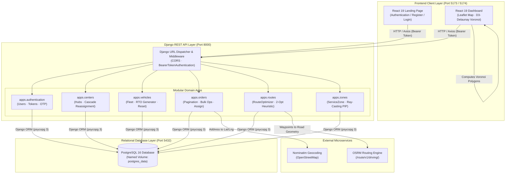
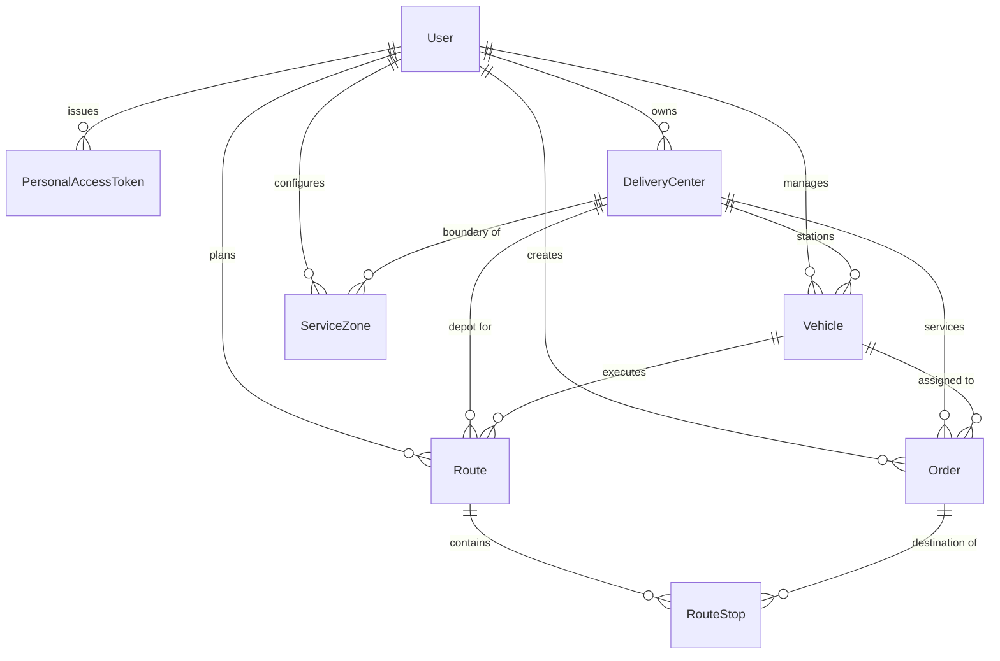

# Routiqo

**Intelligent Fleet Dispatch. Optimized Routes. Smarter Last-Mile Logistics.**

Routiqo is an intelligent, production-ready full-stack logistics management platform engineered to resolve the "Last-Mile Delivery" challenge. Built with **Django REST Framework**, **PostgreSQL 16**, **psycopg 3**, and **React 19**, it pairs spatial partitioning, road-network route optimization, capacity balancing, and real-time interactive mapping to automate fleet dispatch operations within Docker Compose.

---


---

## Table of Contents

- [Overview](#overview)
- [Screenshots](#screenshots)
- [Core Features](#core-features)
- [Technology Stack](#technology-stack)
- [System Architecture](#system-architecture)
- [PostgreSQL Database Architecture & Schema](#postgresql-database-architecture--schema)
- [Project Directory Structure](#project-directory-structure)
- [Docker Compose Setup (Recommended)](#docker-compose-setup-recommended)
- [Local Linux Mint Setup](#local-linux-mint-setup)
- [Environment Configuration](#environment-configuration)
- [Importing Existing MongoDB Atlas Data](#importing-existing-mongodb-atlas-data)
- [Database Persistence and Backups](#database-persistence-and-backups)
- [Application Workflow](#application-workflow)
- [Algorithms and Engineering Details](#algorithms-and-engineering-details)
- [API Documentation](#api-documentation)
- [Testing](#testing)
- [Troubleshooting Common Errors](#troubleshooting-common-errors)
- [Engineering Decisions](#engineering-decisions)
- [Limitations](#limitations)
- [Roadmap](#roadmap)
- [Author](#author)

---

## Overview

In modern supply chain management, the "last mile" represents up to 53% of total shipping costs. Dispatching drivers manually creates overlapping vehicle coverage, wasted mileage, unbalanced driver workloads, and missed customer delivery windows.

**Routiqo** replaces manual dispatching with automated, mathematically sound algorithms:

1. **Voronoi Spatial Partitioning** divides service regions into non-overlapping geometric territories using D3-Delaunay, assigning every customer order to the closest delivery hub.
2. **Dynamic Order Capture & 10 km Radius Constraint** ensures delivery hubs only manage orders within a strict 10 km operational perimeter, while automatically capturing unassigned orders when new hubs open.
3. **Nearest-Neighbor + 2-Opt Heuristics** sequence stops by distance and priority, minimizing total closed-tour distances.
4. **OSRM Road Network Routing** queries real-world road networks to generate turn-by-turn geometries, true driving distances, and accurate travel times rather than straight-line Euclidean approximations.
5. **Fleet Capacity Balancing** distributes packages evenly across available vehicles according to each vehicle's physical capacity limit.
6. **Centralized Interactive Dashboard** visualizes hubs, orders, routes, and playback of simulated vehicle movements in a React 19 interface.

---

## Screenshots

> Visual assets are located in `docs/screenshots/`.

---

## Core Features

- **Hub Management (CRUD)**: Create, inspect, update, and delete delivery depots with geographic coordinates.
- **Fleet Management (CRUD)**: Manage vehicle capacities (1–1000 packages), speed parameters, availability, and automatic RTO plate number generation.
- **Order Management (CRUD & Bulk Ops)**: Create delivery orders with geocoding, assign them to hubs, update delivery dates, filter by status, and execute bulk operations.
- **Automated 10 km Hub Assignment**: Auto-assigns orders to the nearest hub within 10 km; marks orders pending when out of range.
- **Voronoi Zone Generation**: Client-side Voronoi calculation and server-side ray-casting Point-in-Polygon checks.
- **Nearest-Neighbor & 2-Opt Optimization**: Combines greedy nearest-neighbor stop ordering with 2-opt pairwise edge exchange heuristic for high-efficiency route discovery without the exponential latency of exact TSP solvers.
- **OSRM Road Geometry**: Directly calls the Open Source Routing Machine (`/route/v1/driving/`) to render street-conforming GeoJSON polylines on Leaflet.
- **Simulated Rider Movement**: Renders smooth vehicle marker animation along planned route coordinates using time-step interpolation.
- **Secure Authentication & Backward Compatibility**: User authentication with dual-hasher support (Django PBKDF2 with automatic upgrade from legacy bcrypt `$2y$` / `$2b$` hashes), personal access tokens (SHA-256 hashed), and 6-digit email OTP password resets.

---

## Technology Stack

### Backend

| Technology | Version | Purpose |
|---|---|---|
| **Python** | 3.12+ | Core runtime language |
| **Django** | 5.x / 6.x | High-level web framework and request handling |
| **Django REST Framework** | 3.15+ | REST API architecture, serializers, and permissions |
| **PostgreSQL** | 16 | Relational database management system |
| **psycopg (psycopg 3)** | 3.1+ | Modern, high-performance PostgreSQL database driver |
| **django-cors-headers**| 4.3+ | Cross-Origin Resource Sharing control for React clients |
| **bcrypt** | 4.1+ | Cryptographic password verification for legacy Atlas hashes |
| **requests** | 2.31+ | Synchronous HTTP client for OSRM and Nominatim integrations |
| **python-dotenv** | 1.0+ | Twelve-factor application environment variable management |
| **pytest & pytest-django**| 8.0+ / 4.x+ | Automated unit, API, and integration test suite |

### Frontend

| Application | Technology | Version | Purpose |
|---|---|---|---|
| **Dashboard** | **React** | 19.x | Component-driven dispatch interface |
| | **Vite** | 8.x | Frontend build tool and rapid development server |
| | **Tailwind CSS** | 4.x | Utility-first responsive styling and dark mode |
| | **Leaflet / React-Leaflet** | 1.9 / 5.x | Interactive mapping, markers, polylines, and popups |
| | **D3-Delaunay** | 6.x | Client-side Voronoi diagram and Delaunay triangulation |
| | **Axios** | 1.x | Promise-based HTTP client with Bearer auth interceptors |
| | **Framer Motion** | 12.x | Fluid UI animations, modals, and panel transitions |
| | **Lucide React** | 1.x | Modern UI iconography |
| **Landing** | **React & Tailwind CSS**| 19.x / 4.x | Product presentation, account registration, and authentication |

---

## System Architecture



---

## PostgreSQL Database Architecture & Schema

Routiqo uses pure relational Django ORM models backed by PostgreSQL 16. Coordinates are stored in high-precision `DecimalField(max_digits=10, decimal_places=7)`, and variable-length route polylines are stored in native `JSONField`.



### Table Definitions

#### 1. `authentication_user`
- `id` (BigAutoField, PK)
- `email` (EmailField, Unique, Index)
- `name` (CharField)
- `password` (CharField — supports PBKDF2 and legacy bcrypt `$2y$` / `$2b$`)
- `reset_otp_hash` (CharField 64, Nullable)
- `reset_otp_expires` (DateTimeField, Nullable)
- `is_active`, `is_staff`, `is_superuser` (BooleanField)
- `created_at`, `updated_at` (DateTimeField)

#### 2. `authentication_personalaccesstoken`
- `id` (BigAutoField, PK)
- `user_id` (ForeignKey → `authentication_user.id`, CASCADE)
- `name` (CharField)
- `token` (CharField 64, Unique, SHA-256 hash)
- `abilities` (JSONField)
- `last_used_at`, `expires_at` (DateTimeField, Nullable)

#### 3. `centers_deliverycenter`
- `id` (BigAutoField, PK)
- `user_id` (ForeignKey → `authentication_user.id`, CASCADE)
- `name` (CharField 255)
- `latitude` (DecimalField 10,7)
- `longitude` (DecimalField 10,7)
- Indexes: `[user, name]`

#### 4. `vehicles_vehicle`
- `id` (BigAutoField, PK)
- `user_id` (ForeignKey → `authentication_user.id`, CASCADE)
- `delivery_center_id` (ForeignKey → `centers_deliverycenter.id`, CASCADE, Nullable)
- `name` (CharField 255)
- `vehicle_number` (CharField 50)
- `capacity` (PositiveIntegerField, Constraint: 1 <= capacity <= 1000)
- `current_load` (PositiveIntegerField, default 0)
- `average_speed` (DecimalField 6,2, default 25.0)
- `is_available` (BooleanField, default True)
- Indexes: `[user, delivery_center]`, `[user, is_available]`

#### 5. `orders_order`
- `id` (BigAutoField, PK)
- `user_id` (ForeignKey → `authentication_user.id`, CASCADE)
- `delivery_center_id` (ForeignKey → `centers_deliverycenter.id`, SET_NULL, Nullable)
- `vehicle_id` (ForeignKey → `vehicles_vehicle.id`, SET_NULL, Nullable)
- `address` (TextField)
- `latitude` (DecimalField 10,7)
- `longitude` (DecimalField 10,7)
- `delivery_date` (DateField, Index)
- `status` (CharField 20, Index — `pending`, `assigned`, `delivered`)
- `priority` (CharField 20 — `normal`, `priority`)
- Indexes: `[user, status]`, `[user, delivery_date]`, `[user, delivery_center]`

#### 6. `routes_route`
- `id` (BigAutoField, PK)
- `user_id` (ForeignKey → `authentication_user.id`, CASCADE)
- `delivery_center_id` (ForeignKey → `centers_deliverycenter.id`, SET_NULL, Nullable)
- `vehicle_id` (ForeignKey → `vehicles_vehicle.id`, SET_NULL, Nullable)
- `status` (CharField 20, Index — `planned`, `in_progress`, `completed`)
- `profile` (CharField 50, default `shortest_distance`)
- `comparison_batch_id` (CharField 64, Index)
- `total_distance_km` (DecimalField 10,3)
- `total_duration_min` (DecimalField 10,2)
- `total_stops` (PositiveIntegerField)
- `geometry` (JSONField — array of `[lat, lng]` coordinate pairs)
- `departure_at` (DateTimeField, Nullable)

#### 7. `routes_routestop`
- `id` (BigAutoField, PK)
- `route_id` (ForeignKey → `routes_route.id`, CASCADE)
- `order_id` (ForeignKey → `orders_order.id`, SET_NULL, Nullable)
- `stop_index` (PositiveIntegerField)
- `latitude` (DecimalField 10,7)
- `longitude` (DecimalField 10,7)
- `address` (TextField)
- `eta` (DateTimeField, Nullable)
- `distance_from_prev_km` (DecimalField 8,3)
- Constraints: `UniqueTogether(['route', 'stop_index'])`

#### 8. `zones_servicezone`
- `id` (BigAutoField, PK)
- `user_id` (ForeignKey → `authentication_user.id`, CASCADE)
- `delivery_center_id` (ForeignKey → `centers_deliverycenter.id`, CASCADE)
- `polygon_coordinates` (JSONField — array of `[lat, lng]` boundary vertices)
- Indexes: `[user, delivery_center]`

---

## Project Directory Structure

```
Routiqo/
├── docker-compose.yml           # Production Docker Compose orchestration
├── .env.example                 # Root configuration example
├── README.md                    # Root project documentation
│
├── Backend/                     # Django REST Framework backend
│   ├── config/                  # Django project configuration
│   │   ├── settings.py          # Settings (PostgreSQL DATABASES, Auth, DRF)
│   │   ├── urls.py              # Central URL routing
│   │   ├── wsgi.py / asgi.py
│   ├── core/                    # Cross-app utilities
│   │   ├── authentication.py    # BearerTokenAuthentication
│   │   ├── database.py          # UTC datetime helpers
│   │   ├── exceptions.py        # Custom exception handler
│   │   ├── helpers.py           # RouteOptimizer, 2-Opt, Haversine, PIP
│   │   └── serializers.py       # Entity serialization formatters
│   ├── apps/
│   │   ├── authentication/      # User model, token auth, OTP reset
│   │   ├── centers/             # Hub management & order reassignment
│   │   ├── vehicles/            # Fleet management & RTO plates
│   │   ├── orders/              # Orders CRUD, pagination, bulk operations
│   │   ├── routes/              # Route generation & persistence
│   │   └── zones/               # Voronoi service zones & PIP checks
│   ├── scripts/
│   │   └── migrate_from_mongo.py# MongoDB Atlas to PostgreSQL migration utility
│   ├── tests/                   # Pytest automated test suite (33 tests)
│   ├── Dockerfile               # Backend container configuration
│   ├── entrypoint.sh            # Container startup & migration script
│   └── requirements.txt         # Python dependencies
│
├── Dashboard/                   # React 19 Dispatch Dashboard
│   ├── src/                     # Components, pages, Leaflet map, API client
│   ├── Dockerfile               # Dashboard container configuration
│   └── package.json
│
└── Landing/                     # React 19 Landing Page
    ├── src/                     # Components, registration, login
    ├── Dockerfile               # Landing container configuration
    └── package.json
```

---

## Docker Compose Setup (Recommended)

Routiqo runs completely through Docker Compose with 4 coordinated services:
- **`db`**: PostgreSQL 16 (persistent named volume `postgres_data`, automatic health check).
- **`backend`**: Django REST API on port `8000` (waits for `db` health check before executing migrations and launching server).
- **`landing`**: React 19 Landing page on port `5173`.
- **`dashboard`**: React 19 Dashboard on port `5174`.

### One-Command Startup

```bash
docker compose up --build
```

To run in the background (detached mode):

```bash
docker compose up --build -d
```

### Inspecting Logs

```bash
# Stream all logs
docker compose logs -f

# Inspect individual services
docker compose logs -f backend
docker compose logs -f db
docker compose logs -f dashboard
docker compose logs -f landing
```

### Checking Container Health

```bash
docker compose ps
```

All 4 services will report `running` and `db` will report `healthy`.

### Stopping Containers

```bash
# Stop all services
docker compose down

# Stop and remove persistent database volume (warning: erases local data)
docker compose down -v
```

### Application URLs

| Service | Browser URL | Port |
|---|---|---|
| **Landing Page** | [http://localhost:5173](http://localhost:5173) | `5173` |
| **Dashboard** | [http://localhost:5174](http://localhost:5174) | `5174` |
| **Backend API** | [http://localhost:8000/api](http://localhost:8000/api) | `8000` |
| **Health Check** | [http://localhost:8000/up](http://localhost:8000/up) | `8000` |

---

## Local Linux Mint Setup

### 1. Prerequisites Installation

Install Python 3.12+, Node.js 22+, and Docker on Linux Mint / Ubuntu:

```bash
sudo apt update
sudo apt install -y python3-pip python3-venv git curl build-essential libpq-dev

# Install Docker & Docker Compose plugin
sudo apt install -y docker.io docker-compose-v2

# Allow running docker without sudo
sudo usermod -aG docker $USER
newgrp docker
```

Verify installations:
```bash
python3 --version
docker --version
docker compose version
```

### 2. Running via Docker Compose

```bash
git clone https://github.com/YOUR_USERNAME/Routiqo.git
cd Routiqo
docker compose up --build
```

### 3. Running Locally Without Docker (Standalone Mode)

If you prefer running services directly on your host machine:

#### Step 3.1: PostgreSQL Setup
```bash
sudo apt install -y postgresql postgresql-contrib
sudo systemctl start postgresql

# Create database and user
sudo -u postgres psql -c "CREATE USER routiqo_user WITH PASSWORD 'routiqo_password';"
sudo -u postgres psql -c "CREATE DATABASE routiqo OWNER routiqo_user;"
sudo -u postgres psql -c "GRANT ALL PRIVILEGES ON DATABASE routiqo TO routiqo_user;"
```

#### Step 3.2: Backend Setup
```bash
python3 -m venv .venv
source .venv/bin/activate
cd Backend
pip install -r requirements.txt

# Create environment configuration
cp .env.example .env

# Verify database connection
python manage.py check_db

# Apply migrations
python manage.py migrate

# Run tests
pytest -v

# Start development server
python manage.py runserver 0.0.0.0:8000
```

#### Step 3.3: Frontend Setup
In separate terminals:
```bash
# Landing Page
cd Landing && npm install && npm run dev -- --port 5173

# Dashboard
cd Dashboard && npm install && npm run dev -- --port 5174
```

---

## Environment Configuration

Copy `Backend/.env.example` to `Backend/.env`:

```dotenv
# Django Application Configuration
DJANGO_SECRET_KEY=your-secure-secret-key-here
DEBUG=True
ALLOWED_HOSTS=localhost,127.0.0.1,0.0.0.0,backend

# PostgreSQL Database Configuration
DB_HOST=db             # Use 'localhost' if running outside Docker
DB_PORT=5432
DB_NAME=routiqo
DB_USER=routiqo_user
DB_PASSWORD=routiqo_password

# CORS Configuration
CORS_ALLOWED_ORIGINS=http://localhost:5173,http://localhost:5174
CORS_ALLOW_ALL_ORIGINS=False

# OSRM Service Endpoint
OSRM_ENDPOINT=https://router.project-osrm.org

# Application Metadata
APP_NAME=Routiqo
APP_URL=http://localhost:8000
```

---

## Importing Existing MongoDB Atlas Data

If you have existing data in MongoDB Atlas (`routeops.sc1qjqn.mongodb.net / logiroute`), a safe data migration utility is provided at `Backend/scripts/migrate_from_mongo.py`.

### Migration Guarantees
- **Read-Only**: Connects to MongoDB Atlas using read operations; never deletes or modifies MongoDB records.
- **Foreign Key Preservation**: Maps `ObjectId` values to integer primary keys and rebuilds relational foreign keys across all 8 tables.
- **Password Compatibility**: Preserves original bcrypt password hashes ($2y$ / $2b$).
- **Idempotent**: Supports repeated runs; skips existing records without duplicate conflicts.

### Running Data Migration

```bash
cd Backend

# 1. Install PyMongo for the migration tool (if not already installed)
pip install pymongo dnspython

# 2. Set Atlas credentials
export MONGODB_URI="mongodb+srv://<USER>:<PASSWORD>@routeops.sc1qjqn.mongodb.net/logiroute?retryWrites=true&w=majority"
export MONGODB_DATABASE="logiroute"

# 3. Preview import in dry-run mode
python scripts/migrate_from_mongo.py --dry-run

# 4. Perform actual migration
python scripts/migrate_from_mongo.py --skip-existing
```

---

## Database Persistence and Backups

The PostgreSQL container stores data in a named Docker volume (`postgres_data`), ensuring data survives container restarts and image rebuilds.

### Backing Up the Database

```bash
docker compose exec db pg_dump -U routiqo_user -d routiqo > routiqo_backup.sql
```

### Restoring from a Backup

```bash
cat routiqo_backup.sql | docker compose exec -T db psql -U routiqo_user -d routiqo
```

---

## Testing

The backend includes a comprehensive automated test suite running directly against PostgreSQL:

```bash
cd Backend
source ../.venv/bin/activate
pytest -v
```

### Test Suite Coverage (33 Passing Tests)

- **`test_auth.py`** (11 tests): Registration, duplicate prevention, password validation, login, token revocation, profile access, and OTP password reset lifecycle.
- **`test_centers.py`** (4 tests): Center creation, coordinate validation, updates, and cascade deletion order reassignment.
- **`test_vehicles.py`** (5 tests): Automatic RTO number generation, capacity constraints, status toggling, and fleet resets.
- **`test_orders.py`** (5 tests): Auto-assignment within 10 km, out-of-range pending rules, pagination, calendar date counts, and bulk completion.
- **`test_routes.py`** (2 tests): Route generation, 2-opt tour ordering, vehicle load update, route clearance, and legacy bcrypt password compatibility.
- **`test_zones.py`** (1 test): Voronoi polygon storage and point-in-polygon ray-casting query validation.
- **`test_optimization.py`** (5 tests): Haversine distance, nearest-neighbor sequence ordering, total tour distance, route timing calculator, and point-in-polygon containment checks.

---

## Troubleshooting Common Errors

### 1. `Connection to db:5432 failed: Connection refused`
- **Cause**: PostgreSQL has not finished initializing or the container is unhealthy.
- **Solution**: The backend `entrypoint.sh` automatically retries connection for 30 seconds. Run `docker compose ps` to inspect container state and `docker compose logs db` for PostgreSQL initialization messages.

### 2. `FATAL: password authentication failed for user "routiqo_user"`
- **Cause**: Discrepancy between `POSTGRES_PASSWORD` in `docker-compose.yml` and `DB_PASSWORD` in `Backend/.env`.
- **Solution**: Verify that both files match. If resetting credentials on an existing volume, run `docker compose down -v` to re-initialize the volume.

### 3. `django.db.utils.ProgrammingError: relation "..." does not exist`
- **Cause**: Migrations were not applied to the active database.
- **Solution**: Apply migrations manually via `docker compose exec backend python manage.py migrate` or restart the backend container.

### 4. `Port 8000 / 5173 / 5174 already in use`
- **Cause**: An existing process or old container is holding the port.
- **Solution**: Run `docker compose down` and check for host processes:
  ```bash
  sudo lsof -i :8000
  sudo lsof -i :5173
  sudo lsof -i :5174
  ```

---

## Author

**Akshat**  
GitHub: [@akshat-ops](https://github.com/akshat-ops)
